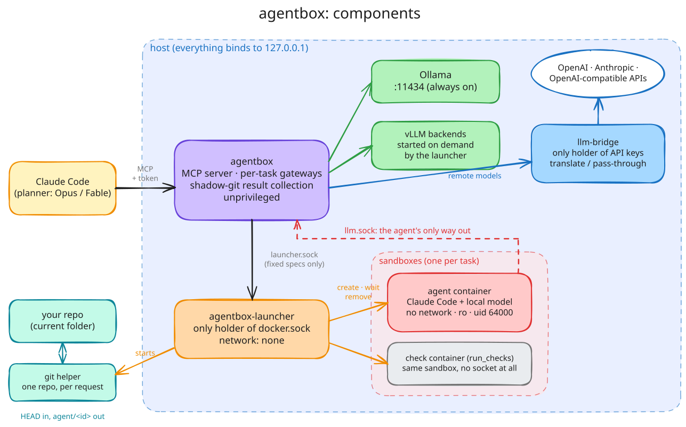

# agentbox

**Sandboxed local coding agents for Claude Code.** Your frontier model plans; an open-weight model running
on your own GPU does the hands-on work inside a hardened, network-less container, and hands the result
back as a git branch for review.



- **One MCP tool, `delegate_task`.** Claude passes a spec and **its current folder**. A local model runs
  Claude Code headless on a scratch copy of that repo's `HEAD`, and you get back the branch `agent/<id>`,
  the diff, and the agent's report.
- **Only the folder you're in is touched.** None of your projects are mounted into agentbox. Each request
  mounts just that one repo, for seconds, in a git helper that runs as you, with no network. The helper
  copies `HEAD` in or writes `agent/<id>` back, and refuses anything that isn't a git repo you own.
- **Hardened by construction.** Each agent gets:
  - no network interface (`--network none`), so it can't install packages, call home, or exfiltrate code;
  - a read-only root filesystem and zero capabilities;
  - a uid that doesn't exist on the host;
  - a per-task gateway that pins the model and meters tokens;
  - optionally (recommended) gVisor's user-space kernel instead of the host's.
  
  Only a tiny launcher holds the Docker socket, and it builds every container spec itself.
- **Safe result collection.** agentbox never runs git inside the agent's `.git` (which the agent controls,
  including hooks and `core.fsmonitor`). Results are committed through a trusted shadow git dir.
- **vLLM, Ollama or OpenAI.** Ollama serves models on demand. vLLM models are started when first needed and
  are never swapped out from under a running agent. Remote models go through **llm-bridge**, the only
  container with provider keys:
  - `backend: openai` covers the OpenAI API or any OpenAI-compatible server, with Messages ⇄ Chat
    Completions translated, including streaming tool calls;
  - `backend: anthropic` passes requests through to the Anthropic API.
  
  The agents stay network-less either way.
- **Review without running agent code on your machine.** `run_checks` runs your tests on the returned
  branch inside the same sandbox. Everything the agent sends back is labelled as untrusted data.
- **A planner skill.** `skills/local-agent-delegation` teaches the planner to write specs that local models
  actually get right, and to review their work before merging.

## Requirements

- Linux with Docker Engine ≥ 27 and Docker Compose v2 (`gpus:` support)
- An NVIDIA GPU with the NVIDIA Container Toolkit. Developed on an NVIDIA GB10 (128 GB unified
  memory); the shipped model configs target that class of machine.
- [`uv`](https://docs.astral.sh/uv/) for the CLI, and [Claude Code](https://claude.com/claude-code) as the planner
- **Recommended:** [gVisor](https://gvisor.dev) (`runsc`), so agents get their own user-space kernel instead
  of sharing the host's. It's optional. `scripts/setup.sh` turns it on automatically when it detects
  `runsc` registered with `--host-uds=open`; see
  [Run agents under gVisor](https://github.com/Adithya-Rajendran/agentbox/wiki/Run-Agents-under-gVisor).

## Quick start

```bash
git clone https://github.com/Adithya-Rajendran/agentbox && cd agentbox
scripts/setup.sh                       # writes .env (ids, paths, fresh MCP token) and config/models.yaml
docker compose --profile build build   # agent image + agentbox image
docker compose up -d                   # ollama, agentbox (MCP), agentbox-launcher, llm-bridge
scripts/smoke-test.sh                  # delegates a tiny bug fix, then checks the result and the sandbox
```

Register it with Claude Code:

```bash
claude mcp add --transport http local-agents http://127.0.0.1:8765/mcp --scope user \
  --header "Authorization: Bearer $(grep ^AGENTBOX_MCP_TOKEN= .env | cut -d= -f2)"
ln -s "$PWD/skills/local-agent-delegation" ~/.claude/skills/   # optional: the planner skill
```

Then, in Claude Code: *"Plan the fix, then delegate the implementation to the local model with
delegate_task, and review the branch it returns."*

## Tools

| Tool | What it does |
|---|---|
| `delegate_task(task, repo_path, model?, max_turns, timeout_minutes, python_env?, …)` | Runs the task in a sandbox. `repo_path` is Claude's current folder. Returns the branch, status, report, diff, token usage and timings. |
| `run_checks(repo_path, branch, command, python_env?)` | Runs a verification command on a branch inside the sandbox. Returns pass/fail plus the output tail. |
| `list_models()` | Lists configured models, what's loaded now, and active tasks. |
| `cleanup_delegation(repo_path, branch)` | Removes a task's scratch clone, shadow git dir and branch. |

The same calls are available from the command line: `uv run --script cli.py models | delegate | check | cleanup`.

## Documentation

The **[wiki](https://github.com/Adithya-Rajendran/agentbox/wiki)** follows the Diátaxis structure:

- **Tutorial:** [Your first delegation](https://github.com/Adithya-Rajendran/agentbox/wiki/Your-First-Delegation)
- **How-to guides:**
  - [Install](https://github.com/Adithya-Rajendran/agentbox/wiki/Installation)
  - [Delegate from Claude Code](https://github.com/Adithya-Rajendran/agentbox/wiki/Delegate-Work-from-Claude-Code)
  - [Write good specs](https://github.com/Adithya-Rajendran/agentbox/wiki/Writing-Good-Specs)
  - [Add a local model](https://github.com/Adithya-Rajendran/agentbox/wiki/Add-a-Local-Model)
  - [Connect OpenAI and other remote APIs](https://github.com/Adithya-Rajendran/agentbox/wiki/Connect-OpenAI-and-Other-Remote-APIs)
  - [Run agents under gVisor](https://github.com/Adithya-Rajendran/agentbox/wiki/Run-Agents-under-gVisor)
  - [Troubleshoot](https://github.com/Adithya-Rajendran/agentbox/wiki/Troubleshooting)
- **Reference:**
  - [MCP tools](https://github.com/Adithya-Rajendran/agentbox/wiki/MCP-Tools)
  - [Configuration](https://github.com/Adithya-Rajendran/agentbox/wiki/Configuration)
  - [Sandbox specification](https://github.com/Adithya-Rajendran/agentbox/wiki/Sandbox-Specification)
  - [Internal APIs](https://github.com/Adithya-Rajendran/agentbox/wiki/Internal-APIs)
- **Explanation:**
  - [How agentbox works](https://github.com/Adithya-Rajendran/agentbox/wiki/How-agentbox-Works)
  - [Security model](https://github.com/Adithya-Rajendran/agentbox/wiki/Security-Model)
  - [How a network-less agent reaches a model](https://github.com/Adithya-Rajendran/agentbox/wiki/How-a-Network-less-Agent-Reaches-a-Model)
  - [Collecting results safely](https://github.com/Adithya-Rajendran/agentbox/wiki/Result-Collection)
  - [Remote models and llm-bridge](https://github.com/Adithya-Rajendran/agentbox/wiki/Remote-Models-and-llm-bridge)
  - [Design decisions](https://github.com/Adithya-Rajendran/agentbox/wiki/Design-Decisions)

Diagrams are Excalidraw sources in [`docs/diagrams/`](docs/diagrams). Open any `.excalidraw` file on
[excalidraw.com](https://excalidraw.com) to edit it, then re-render with `docs/diagrams/render.sh`.

## Status

agentbox is young and built for a single trusted workstation (everything binds to `127.0.0.1`). Read the
[security model](https://github.com/Adithya-Rajendran/agentbox/wiki/Security-Model) before running it
anywhere else. The launcher holds the Docker socket, which is root-equivalent; it is small and does not
parse model output, but it is the component to audit.

## License

[Apache License 2.0](LICENSE).
